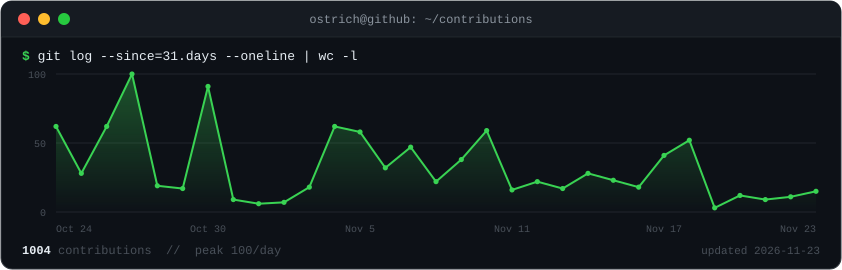

<div align="center">



<br/>

[](https://github.com/ostrich-star)

</div>

---

### Arsenal

```
Languages       TypeScript  -  Python  -  JavaScript  -  Rust  -  Go  -  Bash  -  Swift
Frameworks      Next.js  -  React  -  FastAPI  -  Supabase  -  TanStack Query  -  shadcn/ui
AI              Claude  -  Ollama  -  LM Studio  -  Pipecat  -  RAG  -  Voice agents
Security        Kali  -  Nmap  -  Burp Suite  -  Metasploit  -  Wireshark  -  Hack The Box
Infrastructure  Docker  -  Vercel  -  PostgreSQL  -  Cloudflare  -  Tailscale  -  WireGuard
Platforms       macOS  -  Linux
```

---

### Stats

<div align="center">


<br/>



</div>

---

<div align="center">

*Building in private. Shipping in public.*

</div>
